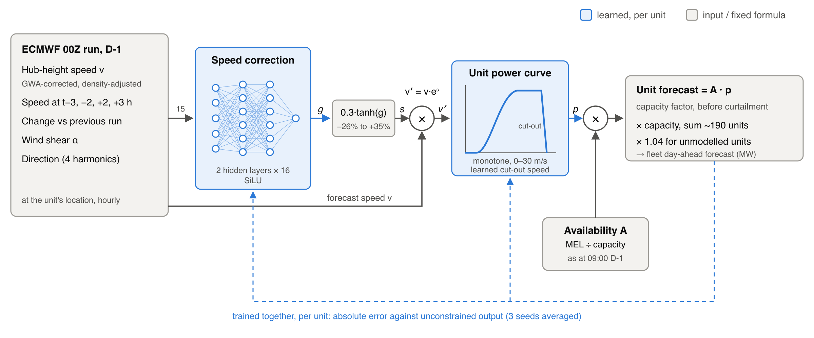

# NESO Forecast
This project attempts to beat NESO's forecasts of wind generation. 

We use archives of the forecasts, attempting to predict the following day's generation with the data available to NESO at 9:30am. 

To predict the generation, we first build power curves from historic generation and wind data. We then set up a neural network, which takes as an input various weather parameters, including wind speed, direction, and wind shear. The neural network and power curve are both trained on 18 months of historic data, with the power curve also allowed to shift slightly to better match observed data. The neural network learns a bounded correction to apply to the wind speed before it is fed into the power curve.

This model outperforms NESO on a mean absolute error basis by 16%, with an average error of 3.6% across the 12 test months against NESOs 4.3%.